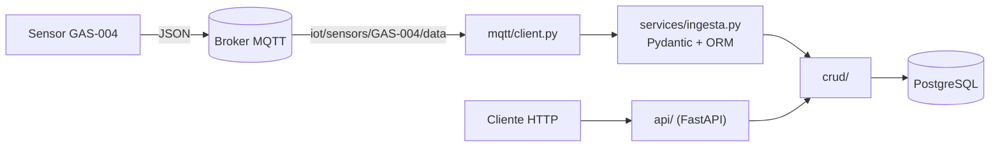
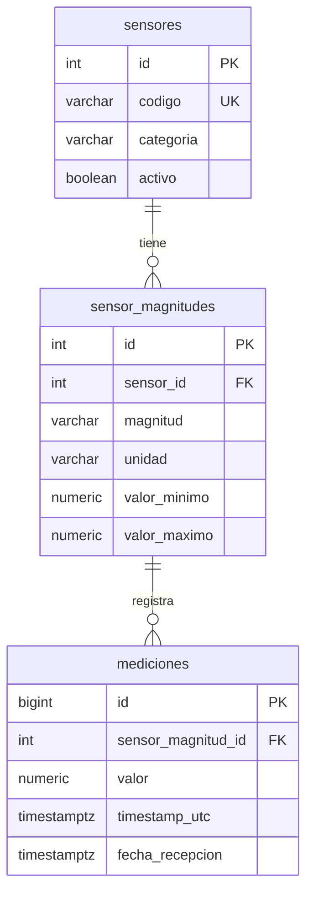

# API IoT — Adquisición y consulta de datos de sensores (Taller 2)

Aplicación que **recibe por MQTT** las mediciones de un sensor, las **valida con Pydantic y el ORM**, las **almacena en PostgreSQL** y las expone con una **API REST (FastAPI)**.

## 1. Información general

| Campo | Detalle |
|---|---|
| Proyecto | API IoT: adquisición (MQTT) y consulta (HTTP) de datos de sensores |
| Integrantes | **Dani Moreno Ciro** Integrante 1 · **Samuel Andres Sanchez Orrego** Integrante 2 |
| Asignatura | Aplicaciones y Servicios Web — ITM |
| Fecha | Octubre de 2026 |
| Sensor asignado | `GAS-004` |
| Tópico MQTT | `iot/sensors/GAS-004/data` |
| Broker | `emqx.coriotlab.co:1883` |
| Rama | `taller-2` |

## 2. Descripción del sistema

### Problema resuelto

Los sensores de una infraestructura IoT publican mediciones periódicas. La aplicación se suscribe al tópico del sensor asignado, valida cada mensaje, **guarda únicamente los válidos** (los inválidos se rechazan y se registran en el log) y permite consultarlos por HTTP con las fechas en hora de Colombia.

### Arquitectura



- La API y el consumidor MQTT corren en **el mismo proceso**: al iniciar `uvicorn`, el `lifespan` de `app/main.py` arranca el suscriptor (hilo propio, reconexión automática, QoS 1). Por eso se ejecuta con **un solo worker**.
- Dependencias entre capas: `api`/`mqtt` → `services`/`crud` → `models`/`database`. El cliente MQTT solo hace transporte; las reglas de negocio están en `services/ingesta.py`.
- La API es de **solo lectura**: las mediciones únicamente se insertan desde MQTT y el catálogo (`sensores`, `sensor_magnitudes`) no se modifica.

### Reglas de validación de la ingesta

| # | Validación | Motivo de rechazo (aparece en el log) |
|---|---|---|
| 1 | Payload UTF-8 y JSON bien formado | `PAYLOAD_NO_DECODIFICABLE`, `JSON_INVALIDO` |
| 2 | Estructura, campos obligatorios y tipos (Pydantic): `sensor_id` y `unit` texto, `value` numérico finito (no texto, no booleano) | `ESTRUCTURA_INVALIDA`, `TIPO_DATO_INVALIDO` |
| 3 | `timestamp` ISO 8601 con zona (UTC) y no futuro (tolerancia configurable, 600 s) | `TIMESTAMP_INVALIDO` |
| 4 | El sensor existe (`sensores.codigo`), es el del tópico asignado y está activo | `SENSOR_INEXISTENTE`, `SENSOR_NO_ASIGNADO`, `SENSOR_INACTIVO` |
| 5 | Cada magnitud: asociada al sensor, unidad igual a la del catálogo y valor dentro de `[valor_minimo, valor_maximo]` | `MAGNITUD_INVALIDA`, `UNIDAD_INCORRECTA`, `VALOR_FUERA_DE_RANGO` |
| 6 | Inserción **atómica**: una fila por magnitud, todas con el mismo `timestamp_utc`, en una sola transacción. Si una magnitud es inválida **no se guarda ninguna** | `ERROR_BASE_DE_DATOS` |

Los rechazos no producen códigos HTTP (no hay petición HTTP): se registran en `logs/app.log` como `RECHAZADO | motivo=...` y no dejan ninguna fila.

### Manejo de fechas

- Se almacenan en **UTC** (`TIMESTAMPTZ`).
- Los GET muestran **hora de Colombia** (America/Bogotá, UTC−05:00, sin horario de verano) en los campos `*_local`, con formato `YYYY-MM-DDTHH:MM:SS-05:00`.
- Filtros `desde` / `hasta` (inclusivos, ISO 8601): con zona (`Z`, `-05:00`) se respeta; **sin zona se interpreta como hora de Colombia**; solo fecha (`2026-10-09`) abarca el día completo. Un `+hh:mm` debe escribirse `%2B` en la URL.

Estructura del mensaje (según la guía del docente):

```json
{
  "sensor_id": "GAS-004",
  "timestamp": "2026-10-07T16:25:30Z",
  "measurements": {
    "<magnitud>": { "value": 0.0, "unit": "<unidad>" }
  }
}
```

`sensor_id` corresponde a `sensores.codigo` (no a la clave numérica `id`); el `timestamp` llega en UTC.

## 3. Configuración del entorno

Requisitos: Python 3.10 o superior y acceso a la base de datos y al broker entregados por el docente.

```powershell
# 1. Entorno virtual (Windows PowerShell; en Linux/macOS: python3 -m venv .venv && source .venv/bin/activate)
py -m venv .venv
.venv\Scripts\Activate.ps1

# 2. Dependencias (versiones fijadas en requirements.txt)
pip install -r requirements.txt

# 3. Variables de entorno
copy .env.example .env      # y completar .env con los datos entregados por el docente
```

Si PowerShell bloquea el script de activación: `Set-ExecutionPolicy -Scope Process -ExecutionPolicy Bypass`.

**Variables de entorno** (plantilla en `.env.example`; el archivo `.env` está en `.gitignore` y **no se sube al repositorio**):

| Variable | Obligatoria | Descripción |
|---|---|---|
| `DB_HOST`, `DB_PORT`, `DB_NAME`, `DB_USER`, `DB_PASSWORD` | Sí | Conexión a PostgreSQL (valores entregados por el docente) |
| `DB_DRIVER` | No | `auto` (por defecto): usa `psycopg` y, si no se puede cargar, `pg8000`. También `psycopg` o `pg8000` |
| `DB_SSLMODE` | No | `require` o `disable` solo si el servidor lo exige; vacío = valor por defecto del controlador |
| `MQTT_BROKER`, `MQTT_PORT` | Sí | Broker MQTT (`emqx.coriotlab.co`, `1883`) |
| `MQTT_TOPIC` | Sí | Tópico exacto del sensor asignado (sin comodines `+` ni `#`) |
| `MQTT_USERNAME`, `MQTT_PASSWORD` | No | Solo si el broker exige autenticación |
| `MQTT_ENABLED` | No | `false` desactiva el consumidor MQTT (por defecto `true`) |
| `MQTT_KEEPALIVE` | No | Segundos de keep-alive (por defecto 60) |
| `LOG_LEVEL` | No | Nivel del log (por defecto `INFO`) |
| `TIMESTAMP_TOLERANCIA_FUTURO_SEGUNDOS` | No | Tolerancia por diferencia de reloj para timestamps futuros (por defecto 600) |

### Ejecución

Todos los comandos se ejecutan desde la carpeta raíz del proyecto, con el entorno virtual activado.

```powershell
python -m scripts.verificar_conexiones                    # Actividad 1: prueba PostgreSQL y MQTT (no escribe en la base)
uvicorn app.main:app --host 127.0.0.1 --port 8000         # API + consumidor MQTT (un solo worker)
python -m scripts.generar_evidencias --url http://127.0.0.1:8000   # evidencias, tras >= 20 min de captura
pytest                                                    # pruebas automáticas (SQLite en memoria, sin red)
```

Documentación interactiva: <http://127.0.0.1:8000/docs> · Estado del servicio: <http://127.0.0.1:8000/salud>. El registro de ejecución se escribe en `logs/app.log` (no se versiona).

## 4. Base de datos

- **Conexión:** SQLAlchemy 2.0 con el controlador `psycopg` (v3); si no se puede cargar (por ejemplo, Windows bloquea su DLL con una directiva de «Control de aplicaciones»), se usa automáticamente `pg8000`, que es Python puro (`DB_DRIVER=auto`). La URL se construye con las variables `DB_*` (`app/core/config.py`) y el engine se crea en `app/database/connection.py` (`pool_pre_ping`, una sesión por petición HTTP y una por mensaje MQTT). Los errores de la base se interpretan por su código SQLSTATE (`app/database/errores.py`), de modo que el comportamiento es el mismo con cualquiera de los dos controladores.
- **Tablas:** `sensores`, `sensor_magnitudes` y `mediciones` (esquema `public`, base `appdb`). El catálogo ya existe y solo se consulta; la aplicación escribe únicamente en `mediciones`.
- **Relaciones implementadas:**



**Correspondencia con `data-model.md`:**

| Tabla | Clase ORM | Archivo | Equivalencias con el modelo |
|---|---|---|---|
| `sensores` | `Sensor` | `app/models/sensor.py` | `codigo` UNIQUE; `categoria` CHECK (`AIRE`, `GAS`, `AGUA`, `AMBIENTE`); `activo` DEFAULT TRUE; `fecha_registro` DEFAULT NOW() |
| `sensor_magnitudes` | `SensorMagnitud` | `app/models/sensor_magnitud.py` | FK `sensor_id` → `sensores.id` (`ON UPDATE CASCADE ON DELETE RESTRICT`); UNIQUE (`sensor_id`, `magnitud`); CHECK `valor_minimo < valor_maximo`; `NUMERIC(12,4)` |
| `mediciones` | `Medicion` | `app/models/medicion.py` | `id` BIGSERIAL; FK `sensor_magnitud_id` → `sensor_magnitudes.id` (`CASCADE`/`RESTRICT`); `valor` `NUMERIC(12,4)`; `timestamp_utc` y `fecha_recepcion` `TIMESTAMPTZ` (`fecha_recepcion` DEFAULT NOW()); los 3 índices del modelo |

Relaciones ORM: `Sensor.magnitudes` ↔ `SensorMagnitud.sensor` y `SensorMagnitud.mediciones` ↔ `Medicion.sensor_magnitud`.

## 5. Organización del código

```text
app/
├── main.py                  # FastAPI, routers y lifespan (arranca/detiene el consumidor MQTT)
├── api/                     # Endpoints HTTP: sensor.py, sensor_magnitud.py, medicion.py, salud.py
├── schemas/                 # Pydantic: payload MQTT (validación) y respuestas HTTP
├── models/                  # Tablas como clases ORM (SQLAlchemy)
├── crud/                    # Consultas ORM; inserción atómica de mediciones
├── services/ingesta.py      # Reglas de negocio de la ingesta MQTT
├── mqtt/client.py           # Suscriptor MQTT (transporte)
├── database/                # connection.py (engine, sesiones, clase base) · errores.py (errores SQLSTATE)
└── core/                    # config.py (.env), tiempo.py (UTC ↔ Colombia), logging_config.py
scripts/                     # verificar_conexiones.py · generar_evidencias.py
tests/                       # Pruebas automáticas (pytest)
evidencias/                  # Evidencias de la Actividad 6
docs/GUIA_TALLER_2.md        # Guía original del docente
```

| Carpeta | Función |
|---|---|
| `schemas/` | Validan datos con Pydantic: `MedicionMQTT` (estructura, tipos y timestamp del payload) y los modelos de respuesta (`SensorOut`, `SensorMagnitudOut`, `MedicionOut`, con fechas en hora de Colombia). |
| `models/` | Describen las tablas y sus claves foráneas como clases ORM; no contienen lógica. |
| `crud/` | Único lugar donde se escribe SQL/ORM: consultas de lectura y `crear_varias` (inserta todas las magnitudes de un mensaje en una transacción). No conoce HTTP ni MQTT. |
| `api/` | Rutas FastAPI: validan parámetros, llaman a `crud/` y devuelven los esquemas; traducen los casos de error a 400/404/422. |
| `mqtt/` | Conexión, suscripción, reconexión y registro de mensajes; delega cada mensaje en `services/ingesta.py`. |
| `database/` | Engine, fábrica de sesiones, dependencia `get_db` e interpretación de errores de la base (`errores.py`). |
| `services/` | Validación en capas y decisión de almacenar o rechazar (`procesar_mensaje`). |

## 6. Endpoints implementados

| Método | Ruta | Descripción |
|---|---|---|
| GET | `/sensores` | Lista sensores. Filtros: `categoria` (`AIRE`, `GAS`, `AGUA`, `AMBIENTE`), `activo`, `skip`, `limit` (1–500, por defecto 100) |
| GET | `/sensores/{id}` | Sensor por ID |
| GET | `/sensores/por-codigo/{codigo}` | Sensor por código (p. ej. `GAS-004`) |
| GET | `/sensores/{id}/magnitudes` | Magnitudes, unidades y rangos del sensor |
| GET | `/sensor-magnitudes/{id}` | Una relación sensor–magnitud por ID |
| GET | `/mediciones/{id}` | Una medición por ID (con magnitud, unidad y sensor) |
| GET | `/sensores/{id}/mediciones` | Histórico del sensor. Filtros combinables: `magnitud`, `desde`, `hasta`, `limit` (últimas N, 1–10000) y `orden` (`desc` por defecto, o `asc`). Sin `limit` devuelve todo el histórico |
| GET | `/sensores/{id}/ultima-medicion` | Medición más reciente del sensor (opcional `magnitud`) |
| GET | `/salud` | Estado de la API, de la base de datos y del consumidor MQTT (contadores de mensajes) |

| Código | Cuándo |
|---|---|
| 200 | Consulta correcta |
| 400 | `desde` es posterior a `hasta` |
| 404 | ID o código inexistente; el sensor no tiene la `magnitud` pedida; el sensor aún no tiene mediciones |
| 422 | Parámetro con tipo o formato inválido (ID no numérico, `limit=0`, fecha mal escrita, ...) |
| 503 / 500 | La base de datos no responde / otro error de base de datos |

Ejemplo de respuesta de `GET /mediciones/{id}` (valores ilustrativos):

```json
{
  "id": 389,
  "sensor_id": 2,
  "sensor_codigo": "GAS-004",
  "sensor_magnitud_id": 5,
  "magnitud": "co2",
  "unidad": "ppm",
  "valor": 412.5,
  "timestamp_local": "2026-10-09T22:14:01-05:00",
  "fecha_recepcion_local": "2026-10-09T22:14:01-05:00"
}
```

## 7. Evidencias de funcionamiento

Las evidencias están en [`evidencias/`](evidencias/) y las genera `python -m scripts.generar_evidencias` (índice con el estado de cada prueba en [`evidencias/resumen.md`](evidencias/resumen.md)). Cada archivo incluye: datos de entrada, resultado obtenido, código HTTP, registro almacenado o rechazado, archivo y función implicados, y una breve explicación.

Las pruebas 3 a 7 y las validaciones adicionales usan mensajes de prueba procesados por la misma función que usa el consumidor, dentro de una transacción que siempre se revierte (no se escribe nada en la base compartida); además, cuando el servicio del docente envió mensajes inválidos reales, se cita la línea correspondiente de `logs/app.log`. Un extracto del registro de ejecución está en [`evidencias/registro_ejecucion.txt`](evidencias/registro_ejecucion.txt).

> **[COMPLETAR]** Resultado de la captura (de `evidencias/resumen.md`): ___ mediciones almacenadas en ___ minutos (mínimo exigido: 20).

| # | Prueba | Evidencia | Archivo y función de la implementación |
|---|---|---|---|
| 1 | Recepción MQTT | [01_recepcion_mqtt.md](evidencias/01_recepcion_mqtt.md) · [00_captura_mqtt_inicial.md](evidencias/00_captura_mqtt_inicial.md) | `app/mqtt/client.py` → `ClienteMQTT._al_conectar`, `_al_recibir` |
| 2 | Medición válida | [02_medicion_almacenada.md](evidencias/02_medicion_almacenada.md) | `app/services/ingesta.py` → `procesar_mensaje`; `app/crud/medicion.py` → `crear_varias` |
| 3 | Sensor inexistente | [03_sensor_inexistente.md](evidencias/03_sensor_inexistente.md) | `app/services/ingesta.py` → `procesar_mensaje` (paso 4); `app/crud/sensor.py` → `obtener_por_codigo` |
| 4 | Unidad incorrecta | [04_unidad_incorrecta.md](evidencias/04_unidad_incorrecta.md) | `app/services/ingesta.py` → `procesar_mensaje` (paso 5) |
| 5 | Tipo de dato incorrecto | [05_tipo_dato_incorrecto.md](evidencias/05_tipo_dato_incorrecto.md) | `app/schemas/medicion.py` → `MagnitudMQTT`, `MedicionMQTT`; `app/services/ingesta.py` → `_clasificar_errores_pydantic` |
| 6 | Magnitud incorrecta | [06_magnitud_incorrecta.md](evidencias/06_magnitud_incorrecta.md) | `app/services/ingesta.py` → `procesar_mensaje` (paso 5); `app/crud/sensor_magnitud.py` → `listar_por_sensor` |
| 7 | Timestamp inválido | [07_timestamp_invalido.md](evidencias/07_timestamp_invalido.md) | `app/schemas/medicion.py` → `_validar_timestamp`; `app/core/tiempo.py` → `parsear_timestamp_mqtt` |
| 8 | Consulta por ID existente | [08_consulta_por_id_existente.md](evidencias/08_consulta_por_id_existente.md) | `app/api/medicion.py` → `obtener_medicion`; `app/crud/medicion.py` → `obtener` |
| 9 | Consulta por ID inexistente (404) | [09_consulta_por_id_inexistente_404.md](evidencias/09_consulta_por_id_inexistente_404.md) | `app/api/medicion.py` → `obtener_medicion` |
| 10 | Consulta histórica | [10_consulta_historica.md](evidencias/10_consulta_historica.md) | `app/api/medicion.py` → `listar_mediciones_del_sensor`; `app/crud/medicion.py` → `listar_por_sensor` |
| 11 | Consulta por rango de fechas | [11_consulta_por_rango_de_fechas.md](evidencias/11_consulta_por_rango_de_fechas.md) | `app/api/medicion.py` → `_fecha_o_422`; `app/core/tiempo.py` → `parsear_filtro_fecha` |
| 12 | Rango `desde > hasta` (400) | [12_rango_invalido_400.md](evidencias/12_rango_invalido_400.md) | `app/api/medicion.py` → `listar_mediciones_del_sensor` |
| 13 | Validación HTTP incorrecta (422) | [13_validacion_http_422.md](evidencias/13_validacion_http_422.md) | `app/api/dependencias.py` → `IdSensor`, `IdMedicion`; `app/api/medicion.py` → `Query(ge=1)` y `_fecha_o_422` |
| 14 | Última medición | [14_ultima_medicion.md](evidencias/14_ultima_medicion.md) | `app/api/medicion.py` → `obtener_ultima_medicion`; `app/crud/medicion.py` → `ultima_por_sensor` |
| 15 | Últimas N mediciones | [15_ultimas_n_mediciones.md](evidencias/15_ultimas_n_mediciones.md) | `app/api/medicion.py` → `listar_mediciones_del_sensor` (`limit`); `app/crud/medicion.py` → `listar_por_sensor` |
| 16 | Filtro por magnitud | [16_filtro_por_magnitud.md](evidencias/16_filtro_por_magnitud.md) | `app/api/medicion.py` → `listar_mediciones_del_sensor` (`magnitud`); `app/crud/sensor_magnitud.py` → `obtener_por_sensor_y_magnitud` |
| 17 | Claves foráneas | [17_claves_foraneas.md](evidencias/17_claves_foraneas.md) | `app/models/sensor_magnitud.py` → `SensorMagnitud.sensor_id`; `app/models/medicion.py` → `Medicion.sensor_magnitud_id` |
| 18 | Separación de responsabilidades | [18_separacion_de_responsabilidades.md](evidencias/18_separacion_de_responsabilidades.md) | Estructura de `app/` (tabla de la sección 5) |
| — | Validaciones adicionales (rango, todo o nada, sensor ajeno, timestamp futuro) | [extra_validaciones_adicionales.md](evidencias/extra_validaciones_adicionales.md) | `app/services/ingesta.py` → `procesar_mensaje` (pasos 3 a 5) |

Pruebas automáticas: `pytest` ejecuta las validaciones de ingesta, los endpoints, el manejo de fechas y el cliente MQTT (`tests/`) con SQLite en memoria; no toca la base compartida ni el broker.

## 8. Control de versiones

- **Repositorio:** <https://github.com/Samuel-Sanchez24/AppServices.git> — rama `taller-2`.
- **Evidencia de commits:** historial completo en <https://github.com/Samuel-Sanchez24/AppServices/commits/taller-2>. Salida de `git log --pretty=format:"%h | %an | %ad | %s" --date=short`:


## 9. Conclusiones

<!-- Borrador: ajustar con la experiencia real del equipo. -->

**Principales aprendizajes**
- MQTT desacopla al sensor de la aplicación (publicación/suscripción): el consumidor recibe los datos cuando el sensor los publica, sin consultarlo.
- Conviene validar por capas: Pydantic para estructura y tipos, y el ORM para las reglas que dependen del catálogo (sensor, magnitud, unidad, rango).
- Guardar en UTC y convertir a hora de Colombia solo al responder evita ambigüedades de zona horaria.
- Separar `api`, `crud`, `models`, `schemas`, `services` y `mqtt` permitió probar la lógica sin red ni base de datos remota.

**Dificultades encontradas**
- Los callbacks de `paho-mqtt` corren en un hilo distinto al de FastAPI; cada mensaje necesita su propia sesión de base de datos.
- Python acepta `True` como número y `NaN`/`Infinity` en JSON; había que rechazarlos explícitamente.
- Un mensaje con varias magnitudes debía guardarse completo o no guardarse (atomicidad).
- La base de datos es compartida con otros grupos: solo se procesa el sensor asignado y las pruebas de rechazo se hacen en transacciones revertidas.
- En Windows, `zoneinfo` necesita el paquete `tzdata` para conocer `America/Bogota`.

**Soluciones aplicadas**
- Una transacción por mensaje (`crear_varias`) y validación previa de todas las magnitudes.
- Validadores estrictos de tipos y comprobación de que el payload corresponde al tópico asignado.
- Un solo worker de `uvicorn` para tener un único consumidor MQTT, con reconexión automática y un `client_id` único.
- Registros de ejecución (`logs/app.log`) que explican el motivo de cada rechazo.
